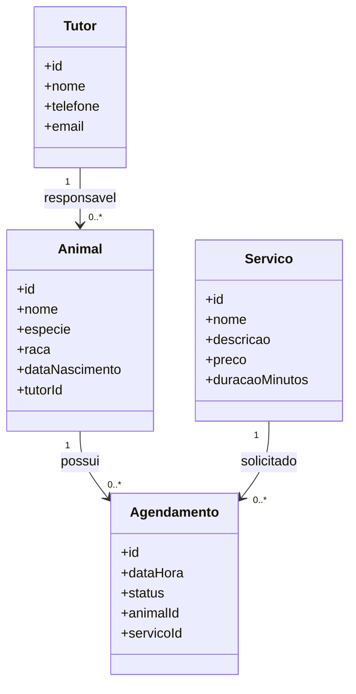

# Modelagem do Sistema de Gerenciamento de Pet Shop

## 1. Descrição do domínio

O sistema de gerenciamento de pet shop tem como objetivo organizar os animais atendidos, seus tutores, os serviços oferecidos e os agendamentos. A modelagem representa as principais informações do domínio e separa as responsabilidades das entidades, dos serviços e dos repositórios.

## 2. Entidades e relacionamentos

O modelo contém quatro entidades:

- **Tutor:** representa a pessoa responsável por um ou mais animais. Possui identificador, nome, telefone e e-mail.
- **Animal:** representa um animal cadastrado no pet shop. Possui identificador, nome, espécie, raça, data de nascimento e uma referência ao tutor responsável.
- **Servico:** representa um serviço oferecido pelo estabelecimento, como banho, tosa ou consulta. Possui identificador, nome, descrição, preço e duração estimada.
- **Agendamento:** registra a reserva de um horário para um animal realizar determinado serviço. Possui identificador, data e hora, status e referências ao animal e ao serviço.

### Relacionamentos

- Um tutor pode ser responsável por vários animais.
- Cada animal possui um tutor responsável.
- Um animal pode ter vários agendamentos.
- Um serviço pode estar associado a vários agendamentos.
- Cada agendamento está associado a um animal e a um serviço.

## 3. Diagrama de classes

## 4. Responsabilidades dos serviços

Os serviços concentram as regras de negócio e coordenam as operações da aplicação.

- **TutorService:** valida os dados e coordena o cadastro, a consulta e a atualização dos tutores.
- **AnimalService:** coordena o cadastro e a consulta dos animais, verificando a existência do tutor responsável.
- **ServicoService:** coordena o cadastro, a consulta e a atualização dos serviços oferecidos.
- **AgendamentoService:** valida os dados do agendamento, verifica a disponibilidade de horários e coordena a criação, a consulta, a alteração e o cancelamento dos agendamentos.

Os serviços não devem executar comandos SQL diretamente nem depender de uma implementação específica de banco de dados. A persistência deve ser delegada aos contratos de repositório.

## 5. Responsabilidades dos repositórios

Os repositórios abstraem o acesso e a persistência dos dados. Cada contrato define as operações disponíveis para sua entidade.

- **TutorRepository:** define operações para salvar, buscar, listar, atualizar e remover tutores.
- **AnimalRepository:** define operações para salvar, buscar, listar, atualizar e remover animais.
- **ServicoRepository:** define operações para salvar, buscar, listar, atualizar e remover serviços.
- **AgendamentoRepository:** define operações para salvar, buscar, listar, atualizar e remover agendamentos, além de consultas para verificar horários ocupados.

As interfaces ou contratos definem o que cada repositório deve oferecer. As implementações concretas são responsáveis por executar as operações usando a tecnologia de persistência escolhida.

## 6. Aplicação dos princípios SOLID

O princípio **SRP (Single Responsibility Principle)** é aplicado pela separação de responsabilidades: as entidades representam os conceitos do domínio, os serviços concentram as regras de negócio e os repositórios cuidam da persistência. Dessa forma, cada parte possui um motivo principal para mudar. O princípio **DIP (Dependency Inversion Principle)** é aplicado quando os serviços dependem de contratos ou interfaces de repositório, em vez de dependerem diretamente de classes concretas que acessam o banco de dados. Assim, a implementação de persistência pode ser substituída sem alterar diretamente as regras de negócio, facilitando os testes e a manutenção.

## 7. Considerações finais

A modelagem organiza os conceitos principais do pet shop e define limites entre as entidades, as regras de negócio e a persistência. Essa estrutura favorece a manutenção, a testabilidade e a evolução futura da aplicação.
